# HQ: Personal Edition

**A personal command center that each owner makes their own:** their name, colors, logo and pages; a deep-work focus room over HD backgrounds; music from YouTube saved as MP3; the AI they choose (ChatGPT, Claude, Gemini and more); and their projects and notes, all in one app on their own PC.

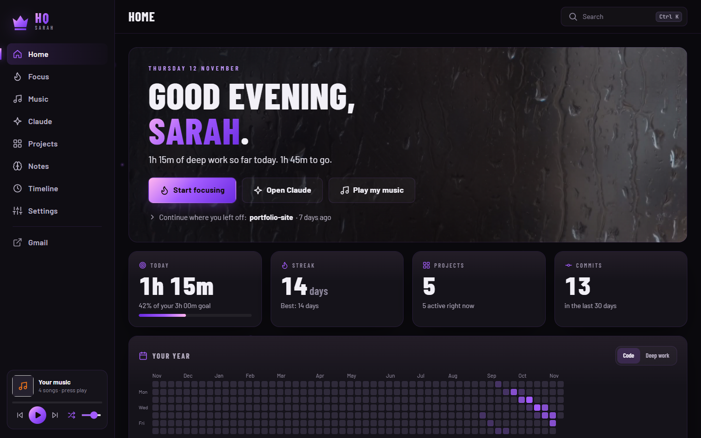

## Download and install

1. Download **`HQ-Personal-<version>-win-x64.zip`** from the [latest release](../../releases/latest).
2. Unzip it and move the **`HQ`** folder somewhere it can stay (for example *Documents*).
3. Double-click **`Start HQ.cmd`** inside it.
   If Windows shows *“Windows protected your PC”*, click **More info → Run anyway**.
4. HQ opens and a two-minute setup makes it yours. On the last step it can put HQ, with **your** logo, on the Desktop and in the Start menu.

Nothing is installed into Windows: no installer, no admin rights, no registry changes, no background service. HQ runs from its folder with the Node.js included in `runtime\node` (the official build, signed by the OpenJS Foundation).

## Make it yours

The first launch is a short setup. Every choice saves as you make it, and the preview on the right updates live. All of it can be changed later in **Settings**.

| | |
|---|---|
| 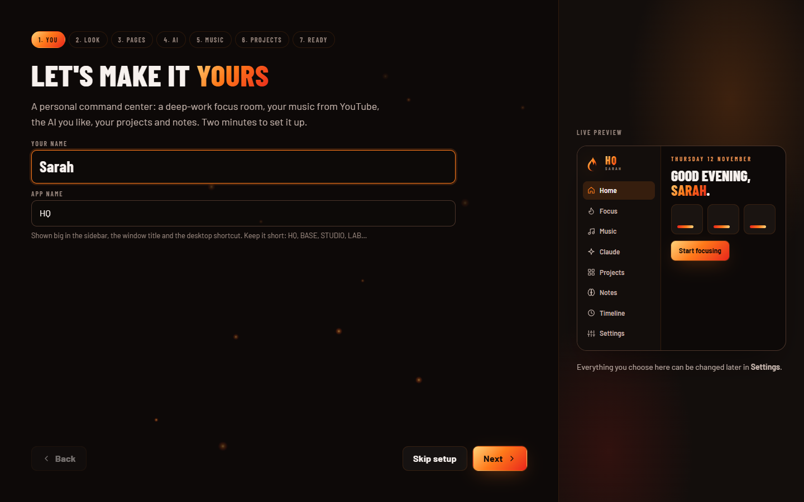 | 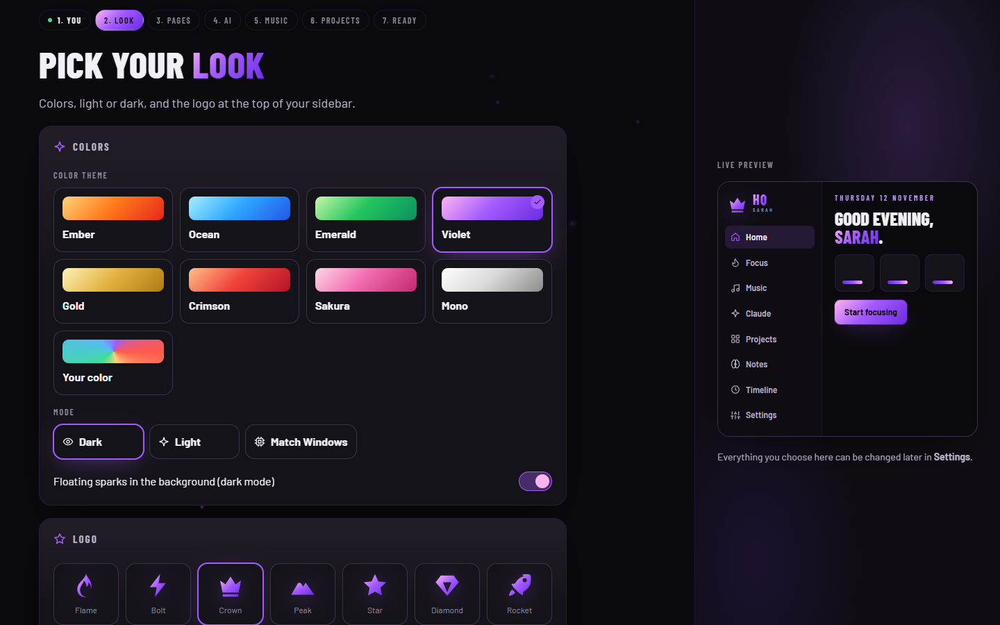 |
| **You**: your name and the app's name (HQ, BASE, STUDIO…) | **Look**: 8 color themes or any color, dark / light / match Windows, 9 logo marks or upload your own |
| 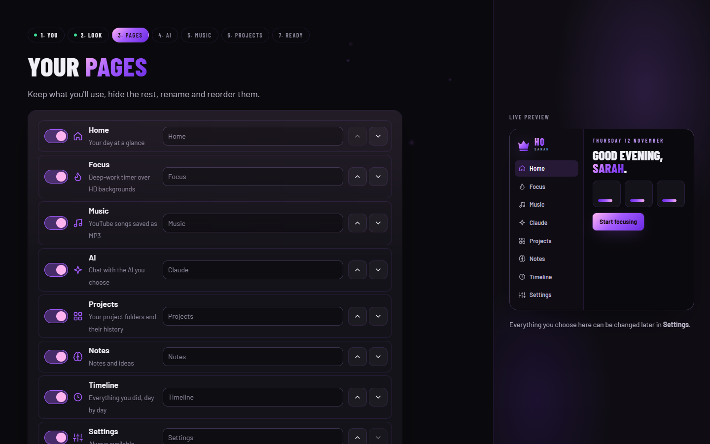 | 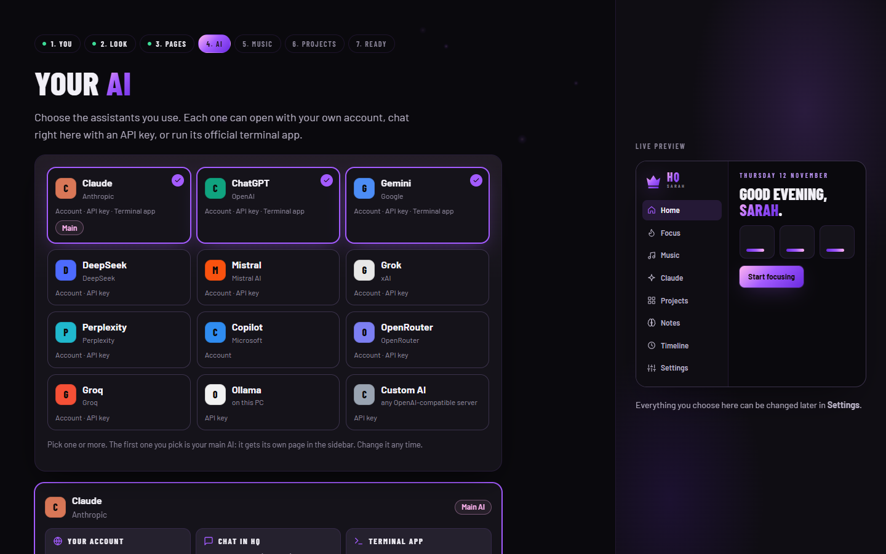 |
| **Pages**: show, hide, rename and reorder every sidebar page | **AI**: pick the assistants you use and your main one |
| 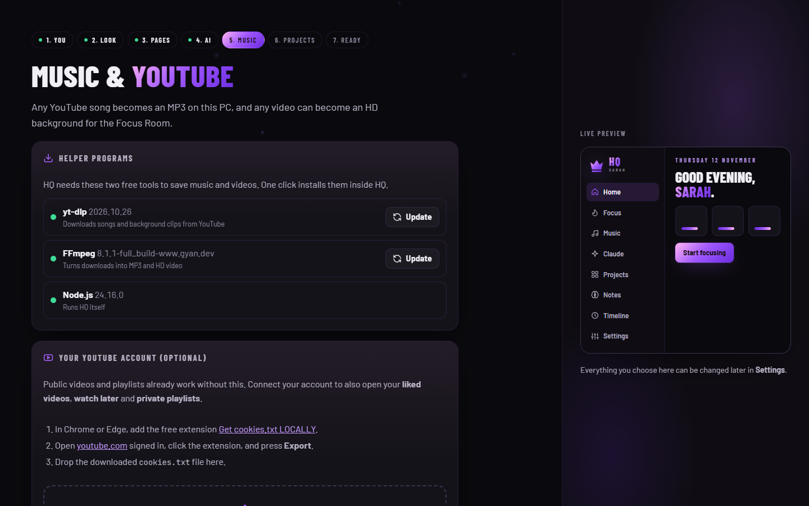 | 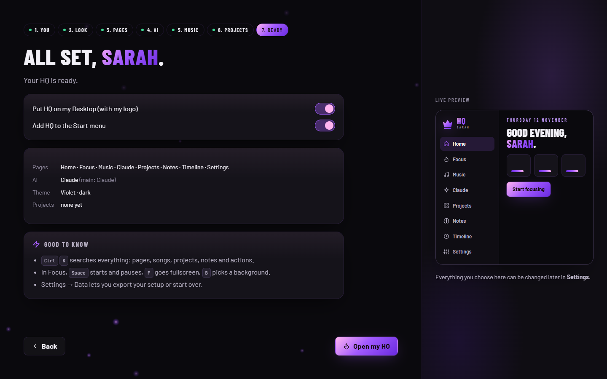 |
| **Music & YouTube**: one-click helper programs, YouTube account, saved playlists | **Ready**: a summary, and your HQ opens |

### Themes

Any theme works in dark or light mode, and the desktop icon follows your logo and colors.

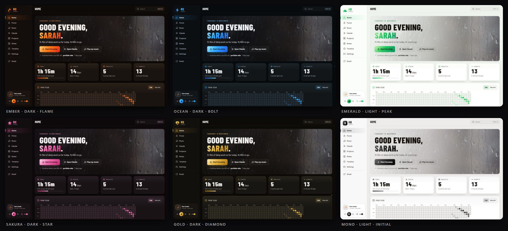

## What's inside

### Focus Room
A server-side deep-work timer (50 / 25 / 90 minutes, breaks, custom), over HD background clips that crossfade forever. Pick a background (`B`), go fullscreen (`F`), start/pause with `Space`. Sessions build a streak, a daily goal and a year heatmap. With no clips yet, it shows a calm animated glow in your theme colors.

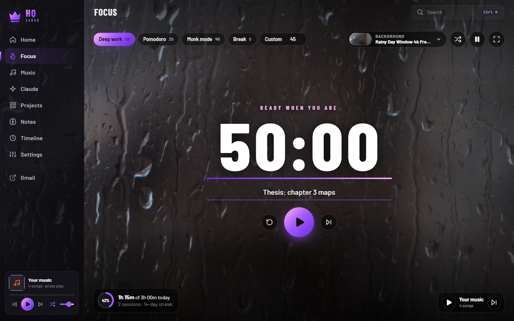

### Music from YouTube
Search YouTube or paste any video or playlist link. Songs are saved as **MP3 on the PC** (instant, offline, full quality) and play in the sidebar player across every page, with media keys. Any video can become an **HD background** for the Focus Room. Connect a YouTube account to open **liked videos**, **watch later** and **private playlists**, and save favorite playlists for one-click access.

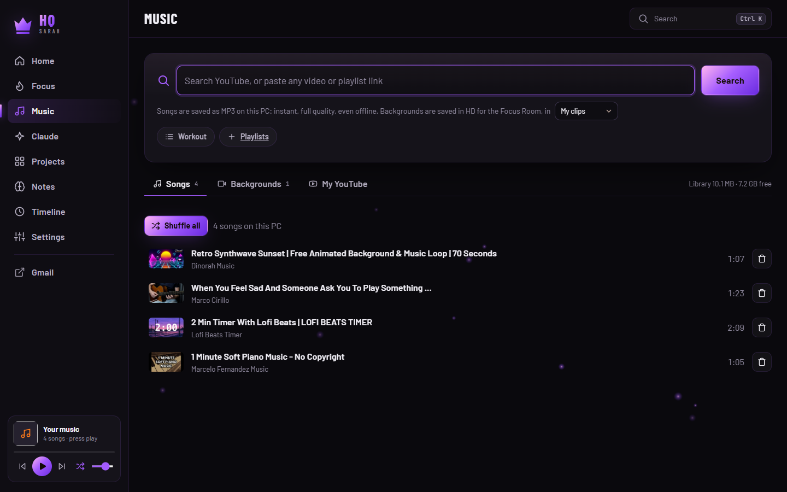

### Your AI, three ways
Choose any of **Claude, ChatGPT, Gemini, DeepSeek, Mistral, Grok, Perplexity, Copilot, OpenRouter, Groq, Ollama** (local and free) or any OpenAI-compatible server. Your main AI gets its own page, named after it.

| Way | What it is | What it needs |
|---|---|---|
| **Website** | The provider's own site in its own window, signed in with **your account** (free or paid plan) | Nothing: just your normal login |
| **Chat in HQ** | HQ's own streaming chat with history, model picker and “About you” instructions | An API key from the provider (stays on your PC) |
| **Terminal** | The official command-line apps: Claude Code, OpenAI Codex, Gemini CLI, installed in one click, signed in with your account | Nothing extra |

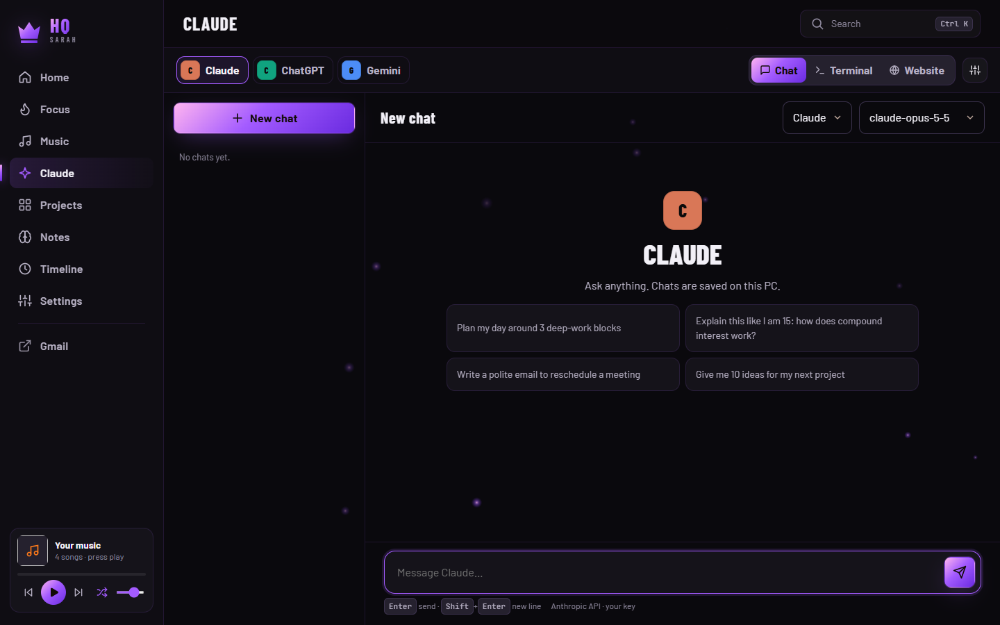

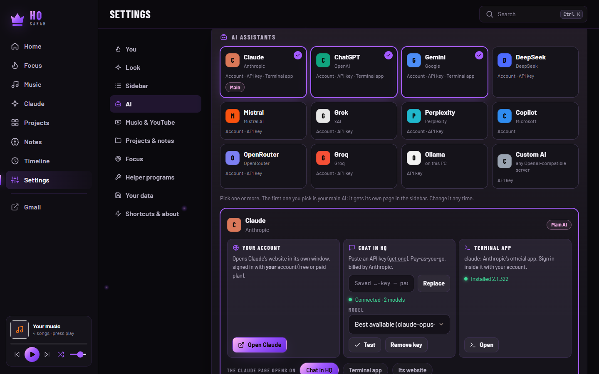

### Projects
Point HQ at the folder where you keep your work: every folder inside becomes a project card, auto-sorted (web, code, hardware, 3D, media, documents). Projects that use Git show their full history with diffs, uncommitted changes and a file browser. Rename, describe, recategorize or hide any project; the folder itself is never touched.

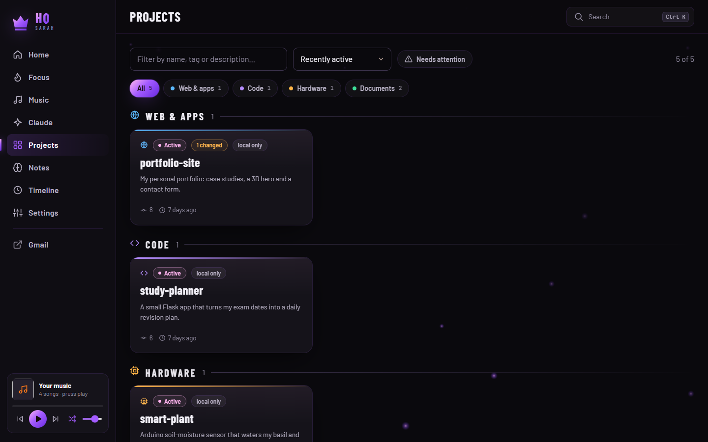

### Notes
A built-in **My notes** folder, plus any folder of Markdown notes (an **Obsidian vault** works great). Write and edit notes, link them with `[[wikilinks]]`, see backlinks and a live link graph, search everything.

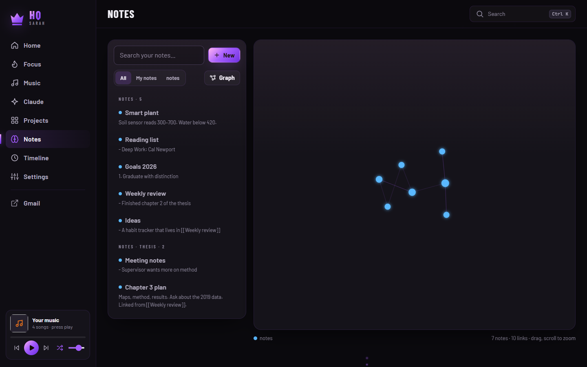

### Timeline, search, shortcuts
- **Timeline**: every focus block, project birth and commit, day by day.
- **`Ctrl K`**: jump to any page, song, project, note or action.
- **Sidebar links**: add your own (Gmail, Notion, school portal…).

## You are in control

**Settings** has every choice from the setup and more: theme, logo, pages, AI accounts and keys, YouTube, folders, focus goal, helper programs, and **Your data**: open the data folder, **export** your setup to a file, **import** it on another PC, run the setup again, or reset.

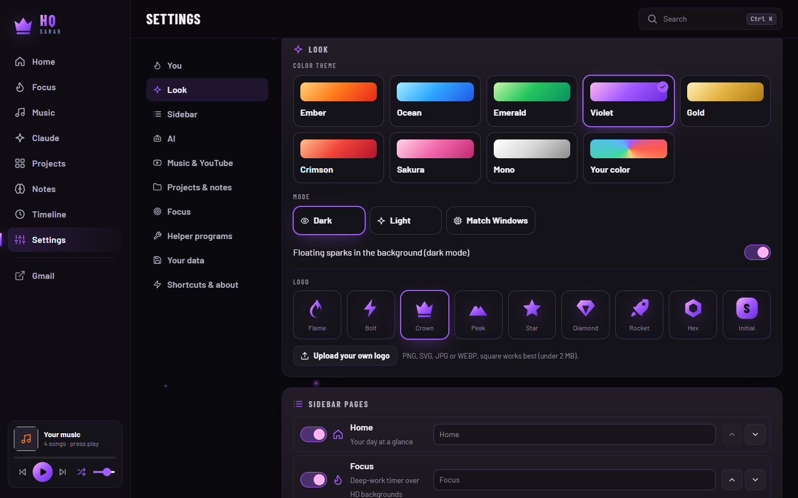

### Privacy
- Everything personal is stored on the PC in **`%LOCALAPPDATA%\HQ`**: settings, API keys, chats, notes, music and backgrounds. Updating or reinstalling HQ never deletes it.
- API keys never leave the PC except to the provider they belong to, and are never shown back in the page (only the last 4 characters).
- HQ only listens on `127.0.0.1` (this PC) and refuses requests from any other website.
- The YouTube connection uses a `cookies.txt` file you export yourself; disconnect any time.

## Requirements
- Windows 10 or 11 (64-bit), internet for YouTube and AI.
- Chrome or Edge (HQ opens as its own app window; Edge comes with Windows).
- Included: Node.js. One click inside HQ: **yt-dlp** and **FFmpeg** (downloaded from their official pages into `%LOCALAPPDATA%\HQ\tools`).
- Optional: Git (project history), GitHub CLI (shows which projects are on GitHub), VS Code (open projects).

## Update and uninstall
- **Update:** close HQ, replace the `HQ` folder with the new one, start it again. Your data, helper programs and AI terminal apps are kept (they live in `%LOCALAPPDATA%\HQ`), and the shortcuts follow the new folder.
- **Remove:** Settings → Your data → turn off the shortcuts, close HQ, delete the `HQ` folder (and `%LOCALAPPDATA%\HQ` to delete your data too).

## Antivirus
HQ is built to look like what it is, a normal app:
- **No installer script.** No PowerShell, no VBScript, no hidden windows; nothing is downloaded or unpacked at install time.
- **`Start HQ.cmd` only runs the bundled `node.exe`**, which is digitally signed by the OpenJS Foundation.
- Shortcuts are made only when the owner asks, by HQ itself (no script host).
- The release build checks Node.js against nodejs.org's checksums and its signature.

HQ itself is not code-signed, so Windows SmartScreen shows *“Windows protected your PC”* the first time (**More info → Run anyway**). Some antivirus programs are wary of **yt-dlp** (a popular free tool HQ downloads on request for music): if one removes it, HQ says so; allow it in the antivirus and press Install again. A code-signing certificate would remove the SmartScreen prompt entirely.

## For developers

```powershell
npm install
npm start               # http://127.0.0.1:9120
npm test                # smoke test against the running app
npm run release         # dist\HQ-Personal-<version>-win-x64.zip
```

| Variable | Default | Purpose |
|---|---|---|
| `HQ_PORT` | `9120` | Port (always bound to 127.0.0.1) |
| `HQ_DATA_DIR` | `%LOCALAPPDATA%\HQ` | Where personal data lives |
| `HQ_CLAUDE_DIR` | `~\.claude\projects` | Claude Code sessions/memory to read (optional features) |

```
server/      Node HTTP server, no framework
  index.mjs    routes, static files, security guard
  config.mjs   settings + API keys, validation, AI provider list
  ai.mjs       chat: Anthropic SDK for Claude, OpenAI-compatible API for the rest
  terminal.mjs Claude Code / Codex / Gemini CLI in a real terminal (node-pty)
  tools.mjs    detects and installs yt-dlp + FFmpeg into %LOCALAPPDATA%\HQ\tools
  shortcuts.mjs Desktop / Start-menu shortcuts written directly in the .lnk format
  media.mjs    YouTube search, MP3 + HD-clip downloads
  catalog.mjs  projects from the chosen folders; git.mjs history; vault.mjs notes
public/      the page (vanilla JS modules, no build step)
  js/lib/theme.js        themes, palette from any color, logo marks, icon renderer
  js/lib/personalize.js  setup + settings building blocks
  js/views/              one file per page (welcome, home, focus, music, ai, …)
launcher.mjs starts the server in the background and opens the app window (used by Start HQ.cmd and the shortcuts)
scripts/     build-release.ps1 (package + bundled Node.js), make-icon.mjs, smoke.mjs
```

## Third-party software
HQ uses [node-pty](https://github.com/microsoft/node-pty) and [xterm.js](https://xtermjs.org/) (MIT), the [Anthropic TypeScript SDK](https://github.com/anthropics/anthropic-sdk-typescript) (MIT), and the Barlow and JetBrains Mono fonts from Google Fonts. On request it downloads [Node.js](https://nodejs.org/), [yt-dlp](https://github.com/yt-dlp/yt-dlp) and an [FFmpeg build](https://github.com/yt-dlp/FFmpeg-Builds) from their official sources; they are not bundled. Downloading from YouTube is subject to YouTube's terms and to copyright: use it for content you have the right to save.

## License
Copyright © 2026 thefhiter. All rights reserved. See [LICENSE](LICENSE).
